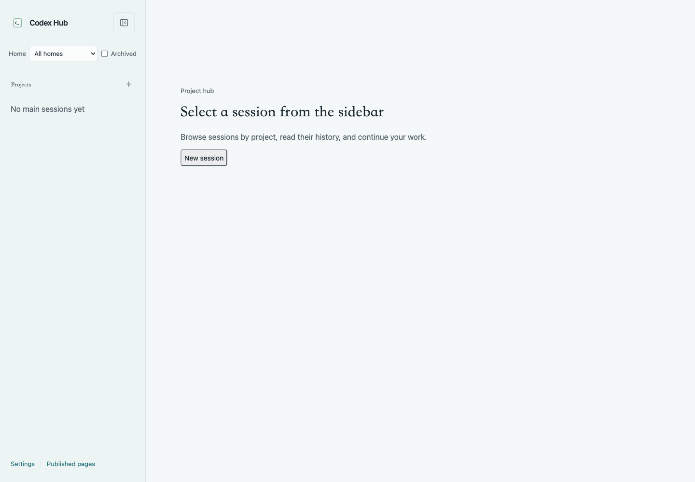
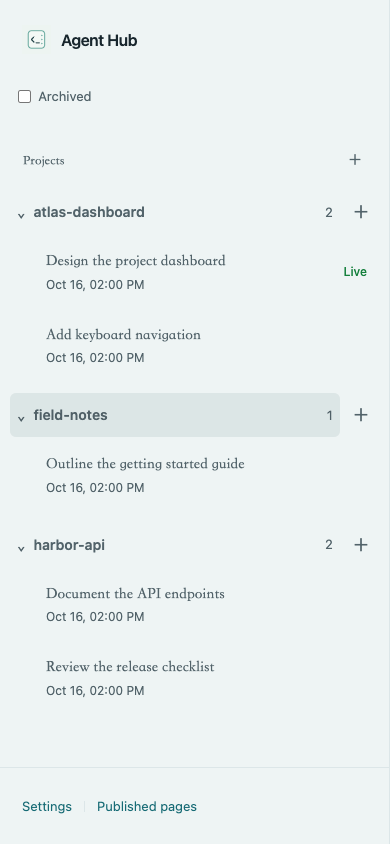
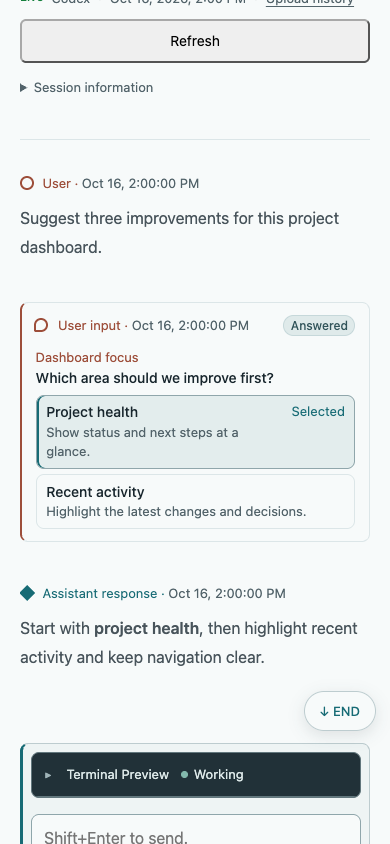
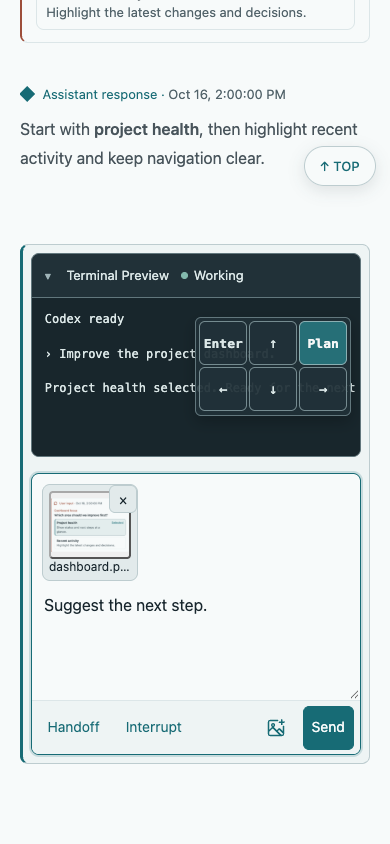
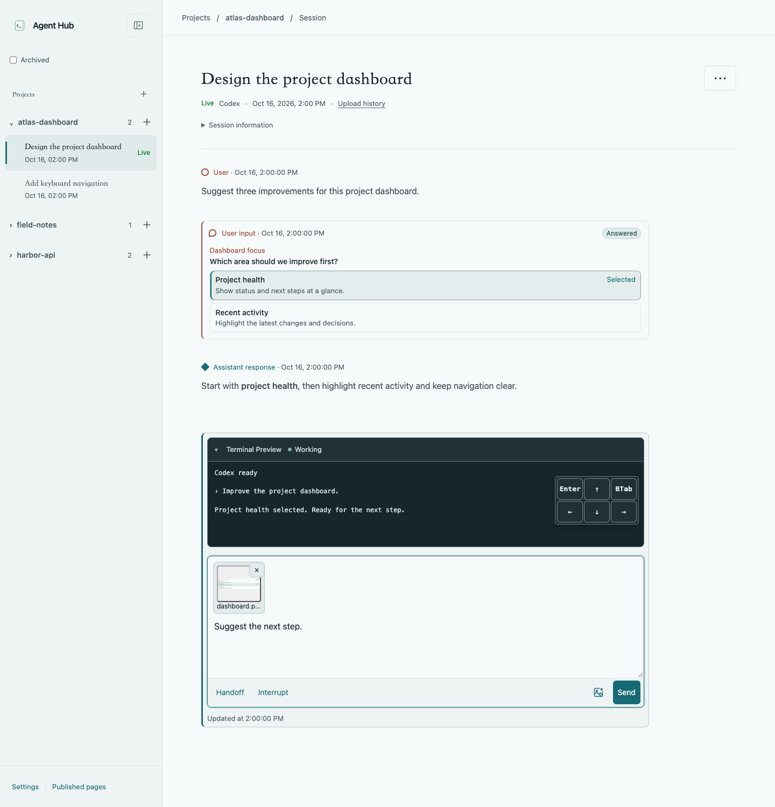

# Agent Hub

English | [简体中文](README.zh-CN.md) | [繁體中文](README.zh-TW.md)

A local web hub for Codex and Claude Code that pairs readable conversations with live CLI interaction.
Browse sessions by project, follow responses in near real time, and keep working with
either runtime from desktop or mobile.



<details>
<summary>Mobile screenshots</summary>





</details>

## Quick start

Runtime requirements:

- macOS or Linux with Node.js >=22.13 and npm
- At least one configured local CLI: Codex or Claude Code
- tmux for creating, resuming, and interacting with sessions

Hub reads `~/.codex` and `~/.claude` by default. You can use either runtime or both;
see [Agent configuration](docs/usage.md#multiple-agents) for custom directories.

Try it without a global installation:

```sh
npx @someonegg/agent-hub@latest
```

Or install it for regular use:

```sh
npm install -g @someonegg/agent-hub
agent-hub
```

Open <http://127.0.0.1:4173>. Open **Settings → Language** at the bottom of the sidebar to switch between English (the default), 简体中文, and 繁體中文. The choice is saved in this browser. Press `Ctrl-C` to stop the server.
For agent configuration, ports, and optional page/diff hosting, see [Usage](docs/usage.md).

To upgrade, run `npm install -g @someonegg/agent-hub@latest` again.
For running from source, see [Development](docs/development.md).

## Features

- Navigate projects, main sessions, and child conversations.
- Read conversation messages, plans, and user input with Markdown, code, tables, and math.
- Follow conversation updates while browsing their history.
- Create sessions with optional worktrees, send input, and preview their terminals.
- View live sessions, resume exited sessions, stop session execution, and archive or delete history.
- [Publish static pages and review diffs](docs/usage.md#publish-pages-and-diffs) with optional local hosting.
- Switch the interface between English, Simplified Chinese, and Traditional Chinese.

## Session interaction

Send prompts and control the live terminal from the session page. Take photos,
paste images, or drop files, then preview and send.
See [file uploads](docs/usage.md#file-uploads) for storage, cleanup, and file limits.

<details>
<summary>Show session interaction screenshot</summary>



</details>

Expand **Terminal Preview** to follow the CLI and handle prompts with the on-screen
controls. See [session interaction](docs/usage.md#send-prompts-and-files) for keyboard
shortcuts, interruption, and Codex session handoff.

## Command-line management

Use `ahub-cli session` to list, create, resume, inspect, and manage sessions from
another terminal, or send input to a live session. Add `--json` for structured
output in scripts and agent workflows.
See [session CLI usage](docs/usage.md#session-commands) for commands and examples.

For agent-assisted session workflows, use the bundled
[`ahub-control` skill](skills/ahub-control). Run
`ahub-cli skill path ahub-control` to locate it. With `npx`, copy the skill
directory from the temporary cache for lasting use.

## Security

Agent Hub reads local session history and controls connected CLI sessions through
tmux. Model access and authentication remain with the configured Codex or Claude
Code CLI; Hub does not manage API keys or CLI credentials.

The server binds to loopback by default. Interaction and management are enabled
without application authentication. Before exposing it to a network, add
authentication, such as the built-in mTLS option, and restrict access. See the
[security guidance](docs/usage.md#access-from-other-devices).

## Documentation

- [Usage and configuration](docs/usage.md)
- [Technical reference](docs/technical-reference.md)
- [Development and screenshots](docs/development.md)
- [All documentation and architecture decisions](docs/README.md)
