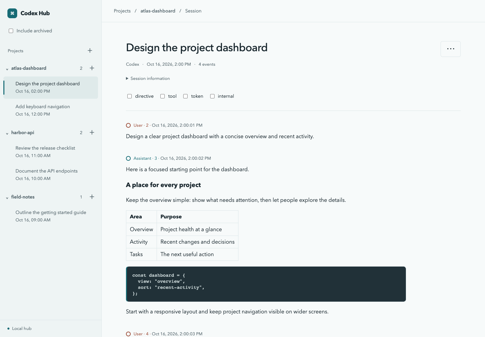

# Codex Hub

A local hub for browsing, creating, and managing Codex sessions by project.
Read conversations, follow live updates, and interact with sessions through tmux.



<details>
<summary>Mobile screenshots</summary>


</details>

## Quick start

Requirements:

- Node.js 22.13 or newer and npm
- A local Codex home (usually `~/.codex`)
- Codex CLI with `--no-daemon`, `--worktree`, `archive`, and `delete --force` support
- tmux for creating and interacting with sessions

```sh
npm ci
npm run build
npm start
```

Open <http://127.0.0.1:4173>. Press `Ctrl-C` to stop the server.
To use a different Codex home or port:

```sh
npm start -- --codex-home /path/to/codex-home --port 4180
```

## Features

- Navigate projects, main sessions, and child conversations.
- Read Markdown, code, tables, and math with optional technical events.
- Follow live conversations while browsing their history.
- Create sessions with optional worktrees, send input, and preview their terminals.
- Archive sessions and permanently delete archived sessions.

## Security

The server binds to loopback by default. Interaction and management are enabled
without application authentication. Before exposing it to a network, add
authentication and restrict access. See the [security guidance](docs/usage.md#security).

## Documentation

- [Usage and configuration](docs/usage.md)
- [Technical reference](docs/technical-reference.md)
- [Development and screenshots](docs/development.md)
- [All documentation and architecture decisions](docs/README.md)
