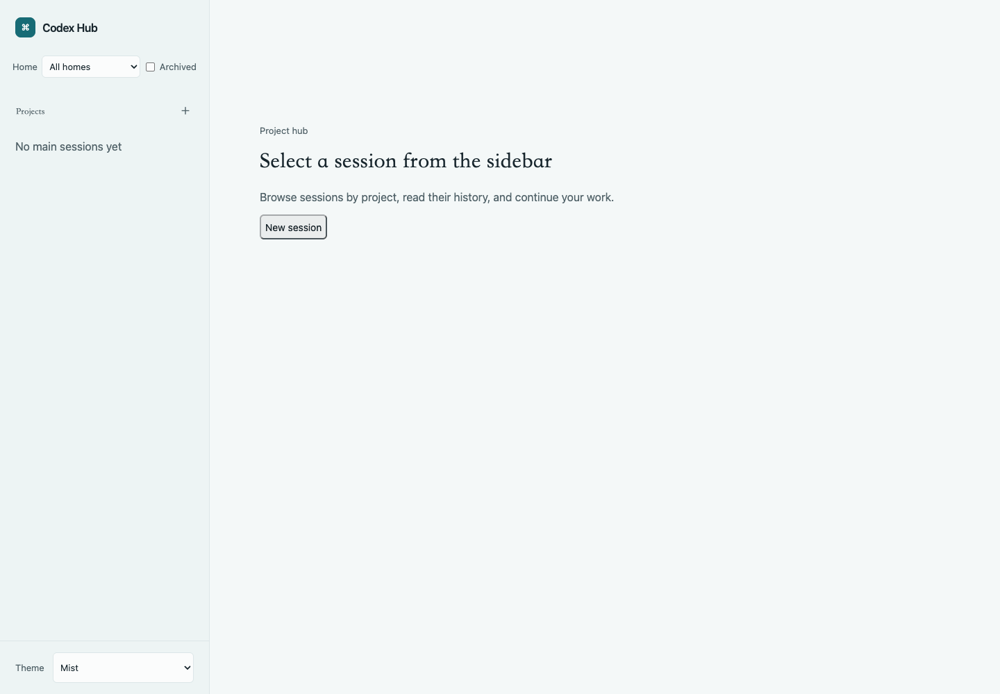
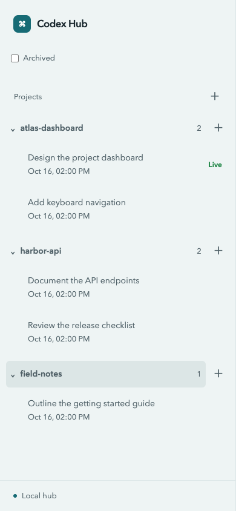
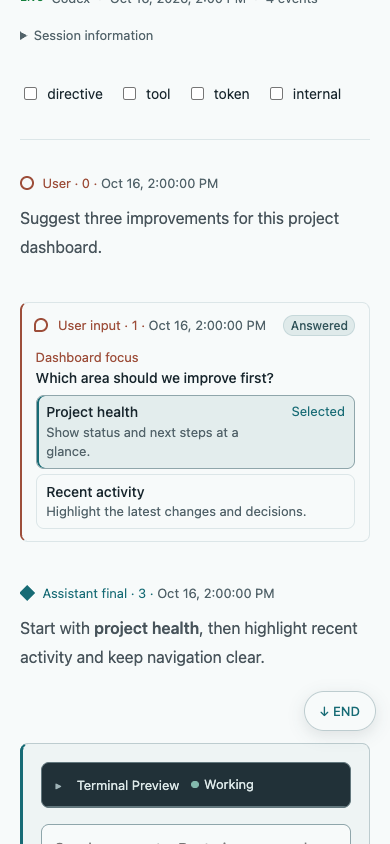
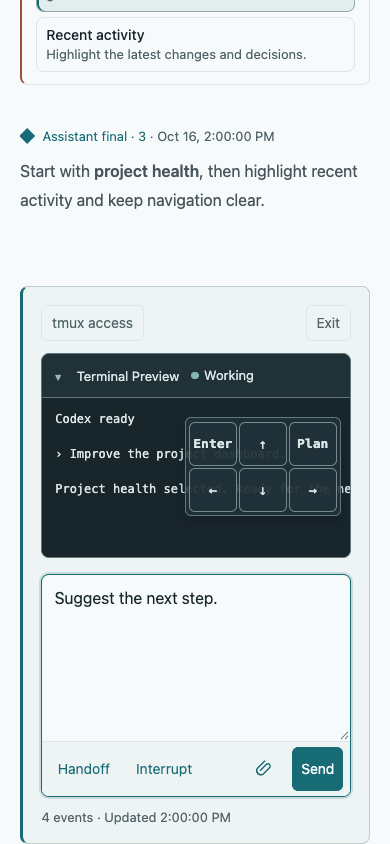
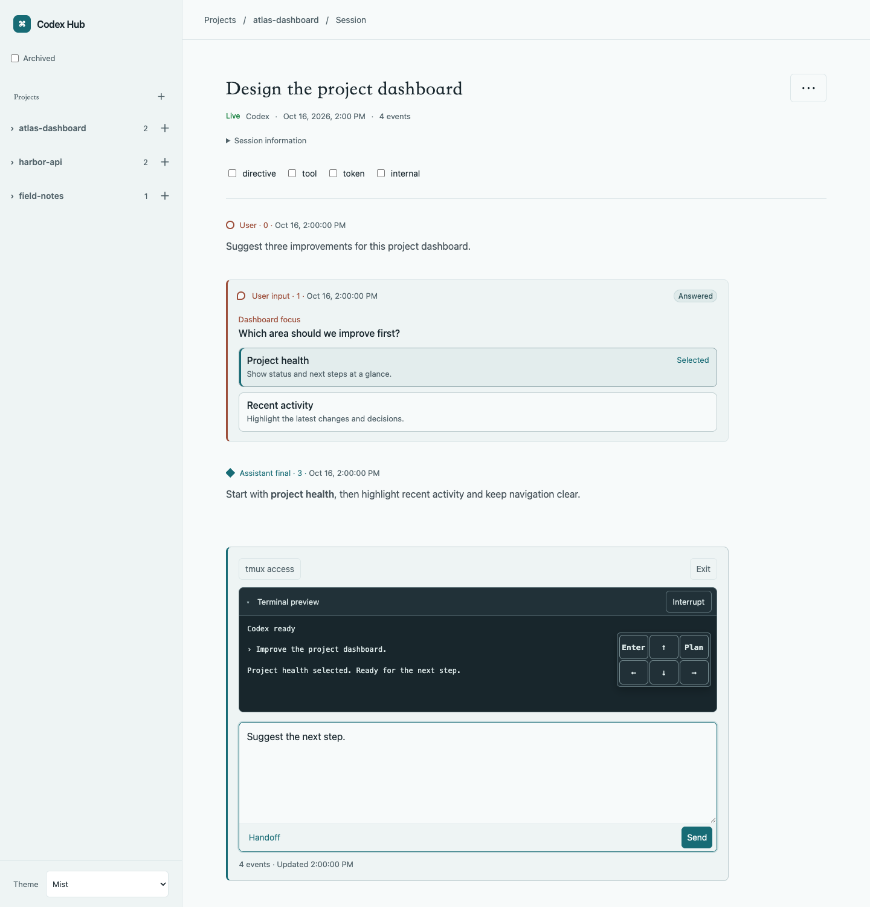
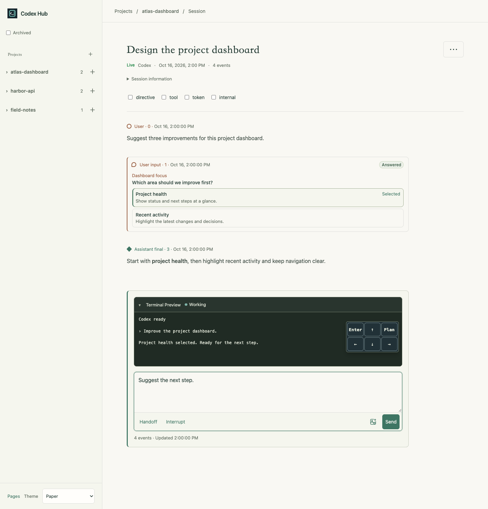

# Codex Hub

A local web hub for Codex that pairs readable conversations with live CLI interaction.
Browse sessions by project, follow responses in near real time, and keep working with
Codex from desktop or mobile.



<details>
<summary>Mobile screenshots</summary>





</details>

## Quick start

Requirements:

- macOS or Linux with Node.js 22.13 or newer and npm
- A local Codex home (usually `~/.codex`)
- Codex CLI with `resume`, `--no-daemon`, `--no-alt-screen`, `--worktree`, `archive`, and `delete --force` support
- tmux for creating and interacting with sessions

Try it without a global installation:

```sh
npx @someonegg/codex-hub@latest
```

Or install it for regular use:

```sh
npm install -g @someonegg/codex-hub
codex-hub
```

Open <http://127.0.0.1:4173>. Press `Ctrl-C` to stop the server.
To use a different Codex home or port:

```sh
codex-hub --codex-home 'personal=/path/to/codex-home' --port 4180
```

To use multiple Codex homes:

```sh
codex-hub \
  --codex-home 'personal=~/.codex' \
  --codex-home 'work=/path/to/codex-work'
```

See [home configuration and usage](docs/usage.md#multiple-homes) for detailed rules.

To upgrade, run `npm install -g @someonegg/codex-hub@latest` again.
For running from source, see [Development](docs/development.md).

## Features

- Navigate projects, main sessions, and child conversations.
- Read Markdown, code, tables, and math with optional technical events.
- Follow conversation updates while browsing their history.
- Create sessions with optional worktrees, send input, and preview their terminals.
- See live sessions, safely resume exited sessions, exit without archiving, and manage archives.

## Session interaction

Send prompts and control the live terminal from the session page. Paste screenshots
or drop files into the message input, then review and send the inserted paths.
See [file uploads](docs/usage.md#file-uploads) for storage, cleanup, and API limits.

<details>
<summary>Show session interaction screenshot</summary>



</details>

### Continue with Handoff

If Codex switches sessions in the same terminal after `/clear`, `/resume`, or
running a plan, click **Handoff** on the previous session's page. Once it shows
**Superseded**, follow **Go to bound session**. Your draft stays on the old page.
See [tmux interaction](docs/usage.md#binding-an-existing-tmux-session) for details.

## Security

Codex Hub reads local session logs and the session index, interacts with Codex
through tmux, and manages sessions through native CLI commands. Authentication
stays with Codex; the hub does not read or manage tokens, API keys, or credential files.

The server binds to loopback by default. Interaction and management are enabled
without application authentication. Before exposing it to a network, add
authentication, such as the built-in mTLS option, and restrict access. See the
[security guidance](docs/usage.md#security).

## Documentation

- [Usage and configuration](docs/usage.md)
- [Technical reference](docs/technical-reference.md)
- [Development and screenshots](docs/development.md)
- [All documentation and architecture decisions](docs/README.md)

<details>
<summary>Paper theme</summary>

Choose **Paper** from the theme list at the bottom of the sidebar. Your choice is saved on this device.



</details>
