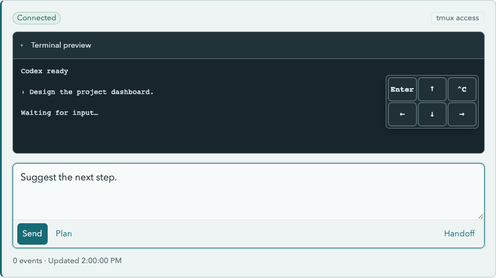

# Codex Hub

A local web hub for Codex that pairs readable conversations with live CLI interaction.
Browse sessions by project, follow responses in near real time, and keep working with
Codex from desktop or mobile.


<details>
<summary>Mobile screenshots</summary>


</details>

## Quick start

Requirements:

- Node.js 22.13 or newer and npm
- A local Codex home (usually `~/.codex`)
- Codex CLI with `--no-daemon`, `--worktree`, `archive`, and `delete --force` support
- tmux for creating and interacting with sessions

```sh
npm ci
npm run build
npm start
```

Open <http://127.0.0.1:4173>. Press `Ctrl-C` to stop the server.
To use a different Codex home or port:

```sh
npm start -- --codex-home /path/to/codex-home --port 4180
```

## Features

- Navigate projects, main sessions, and child conversations.
- Read Markdown, code, tables, and math with optional technical events.
- Follow live conversations while browsing their history.
- Create sessions with optional worktrees, send input, and preview their terminals.
- Archive sessions and permanently delete archived sessions.

## Live pane

Send prompts, preview terminal output, and use terminal controls from the session
page.



### Continue with Handoff

After `/clear`, `/resume`, or clearing context to run a plan, Codex may switch to
another session in the same terminal. On the **previous session's page**, click
**Handoff** to connect the hub to that session. The terminal preview opens after
the request is sent. When the old page shows **Superseded**, follow **Go to bound
session** to continue there. Your draft stays on the old page.

## Security

Codex Hub keeps its integration minimal: it reads local session logs and the
session index to build conversations, and interacts with the Codex CLI as a black
box through tmux. Session management uses native Codex commands. The hub does not
read or manage Codex authentication tokens, API keys, or credential files;
authentication stays with the Codex CLI.

The server binds to loopback by default. Interaction and management are enabled
without application authentication. Before exposing it to a network, add
authentication and restrict access. See the [security guidance](docs/usage.md#security).

## Documentation

- [Usage and configuration](docs/usage.md)
- [Technical reference](docs/technical-reference.md)
- [Development and screenshots](docs/development.md)
- [All documentation and architecture decisions](docs/README.md)
