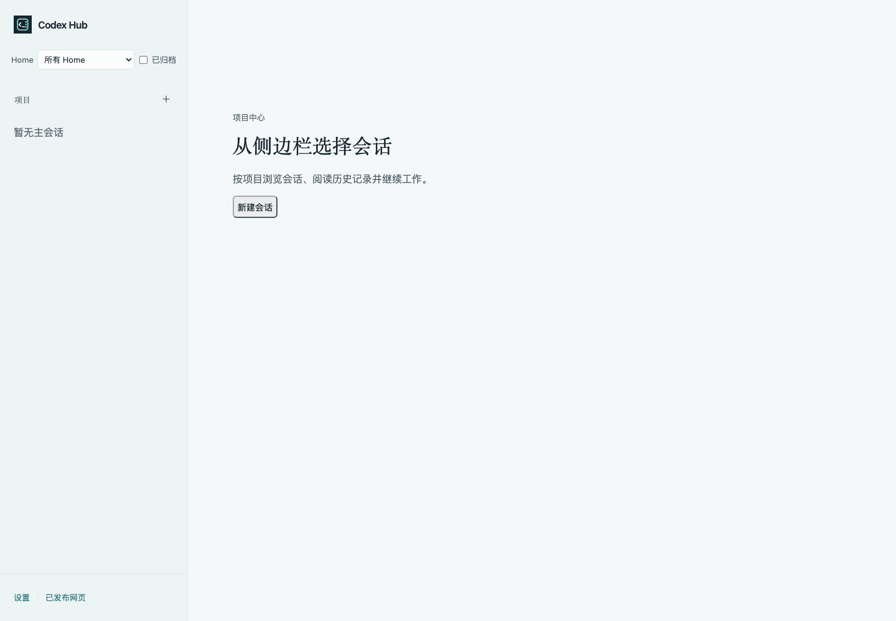
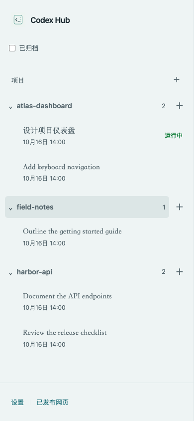
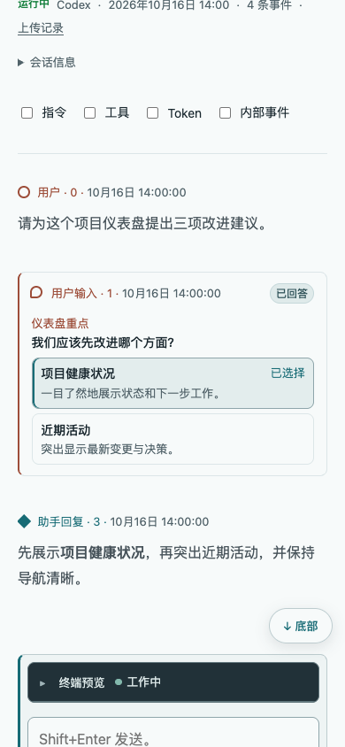
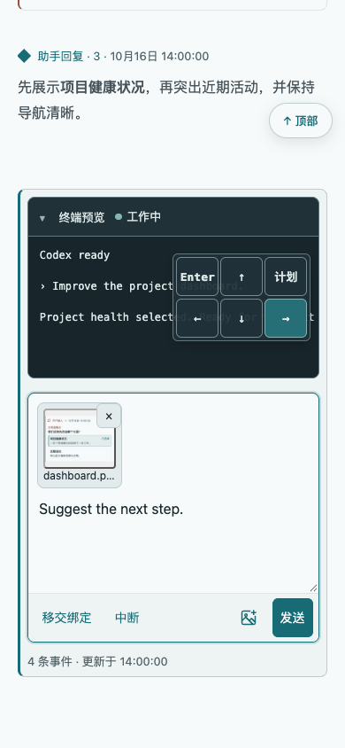
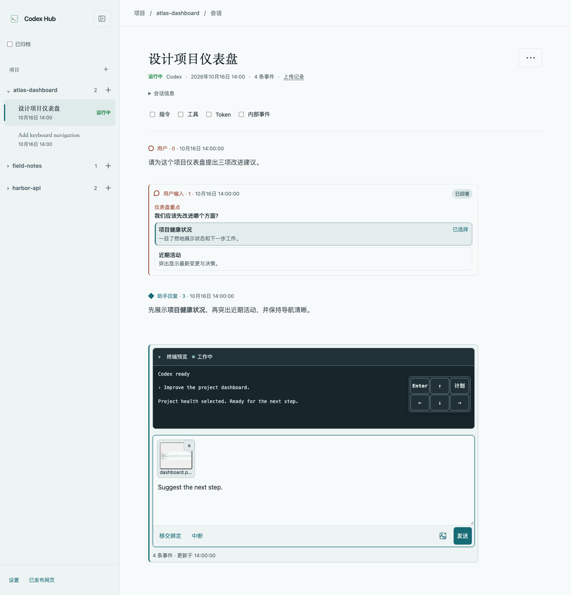

# Codex Hub

[English](README.md) | 简体中文 | [繁體中文](README.zh-TW.md)

面向 Codex 的本地网页中心，将清晰易读的会话记录与实时 CLI 交互结合起来。
按项目浏览会话、跟进最新回复，并从电脑或手机继续工作。



<details>
<summary>手机截图</summary>





</details>

## 快速开始

运行要求：

- macOS 或 Linux，Node.js >=22.13 与 npm
- 本地 Codex Home（通常为 `~/.codex`）
- 支持 `resume`、`--no-daemon`、`--no-alt-screen`、`--worktree`、`archive` 和 `delete --force` 的 Codex CLI
- tmux，用于创建会话和交互

无需全局安装即可试用：

```sh
npx @someonegg/codex-hub@latest
```

也可以安装后长期使用：

```sh
npm install -g @someonegg/codex-hub
codex-hub
```

打开 <http://127.0.0.1:4173>。按 `Ctrl-C` 停止服务器。
界面默认英文，在侧边栏底部打开 **Settings → Language → 简体中文 / 繁體中文** 即可切换；选择保存在当前浏览器。

Home、端口与可选网页／差异托管配置见[使用与配置](docs/usage.zh-CN.md)。

升级时再次执行
`npm install -g @someonegg/codex-hub@latest`。从源码运行请参阅[开发指南（英文）](docs/development.md)。

## 功能

- 按项目浏览主会话和子会话。
- 阅读 Markdown、代码、表格和数学公式，可选显示技术事件。
- 浏览历史记录的同时跟进会话更新。
- 创建会话，可选 worktree；发送输入并预览终端。
- 查看运行中的会话、安全恢复已退出会话、退出而不归档，以及管理归档记录。
- 在英文、简体中文与繁体中文之间切换界面。

## 会话交互

在会话页面发送提示并控制实时终端。可以拍照、粘贴图片或拖放文件，预览后发送。
上传存储、清理和限制见[文件上传](docs/usage.zh-CN.md#文件上传)。

<details>
<summary>查看会话交互截图</summary>



</details>

### 终端预览

展开**终端预览**跟进实时 CLI。使用屏幕按钮，或聚焦预览后按方向键及 **Enter**，处理 CLI 提示。
按 **Ctrl+C** 或点击**中断**可中断执行；**Esc** 收起预览。**工作中**与**空闲**仅反映近期终端输出，不代表任务完成。

### 移交绑定后继续

当 Codex 在同一终端中通过 `/clear`、`/resume` 或执行计划切换会话时，在旧会话页面点击**移交绑定**。
显示**已被替代**后，点击**前往已绑定会话**。未发送草稿保留在旧页面。
详见[与 Codex 交互](docs/usage.zh-CN.md#与-codex-交互)。

## 通过管理 CLI 操作会话

使用 `ahub-cli session` 在另一个终端中列出、创建、恢复、查看和管理会话，或向运行中的会话发送输入。
添加 `--json` 可输出结构化结果，便于脚本和智能体工作流使用。
命令与示例见[会话 CLI 使用说明](docs/usage.zh-CN.md#会话)。

如需智能体协助管理会话，可使用 npm 包附带的
[`ahub-control` skill](skills/ahub-control)。运行
`ahub-cli skill path ahub-control` 查看目录。`npx` 返回缓存路径，长期使用请复制该目录。

## 安全

Codex Hub 读取本地会话日志与索引，通过 tmux 交互，并使用原生 CLI 命令管理会话。
身份认证由 Codex 负责；Hub 不读取或管理令牌、API 密钥或凭据文件。

服务器默认仅监听回环地址，交互和管理功能没有应用层登录保护。对外开放前，请添加身份认证
（例如内置 mTLS）并限制访问。参阅[安全说明](docs/usage.zh-CN.md#安全)。

## 文档

- [使用与配置](docs/usage.zh-CN.md)
- [技术参考（英文）](docs/technical-reference.md)
- [开发与截图（英文）](docs/development.md)
- [全部文档与架构决策](docs/README.md)
