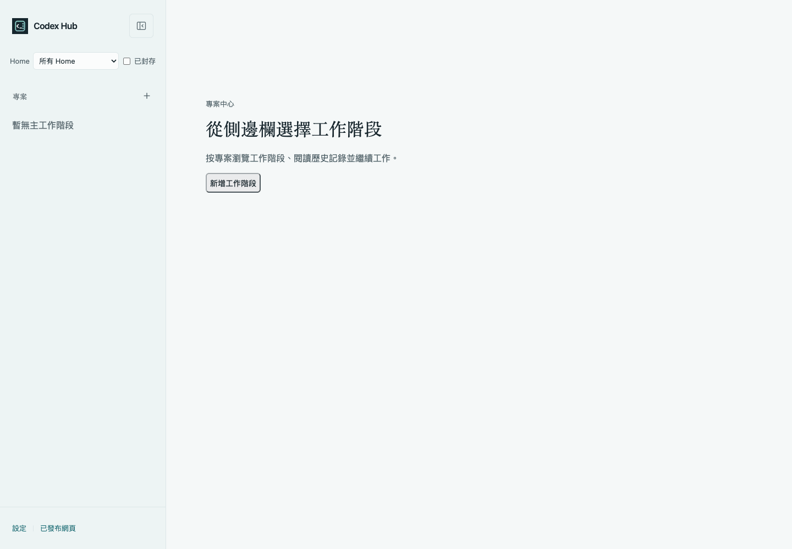
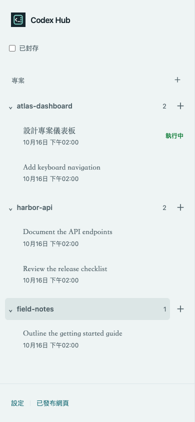
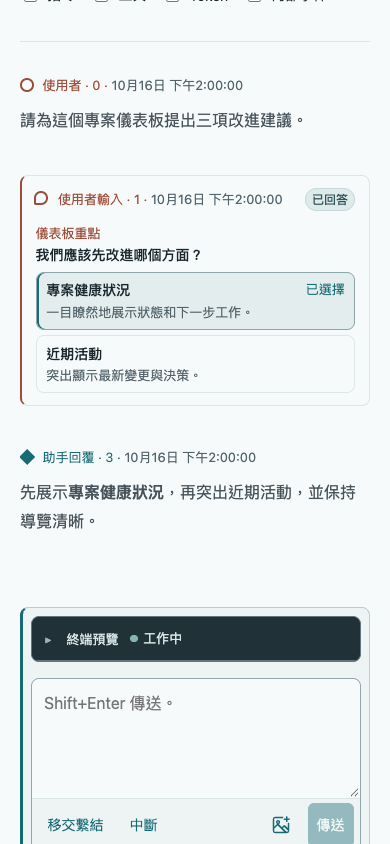
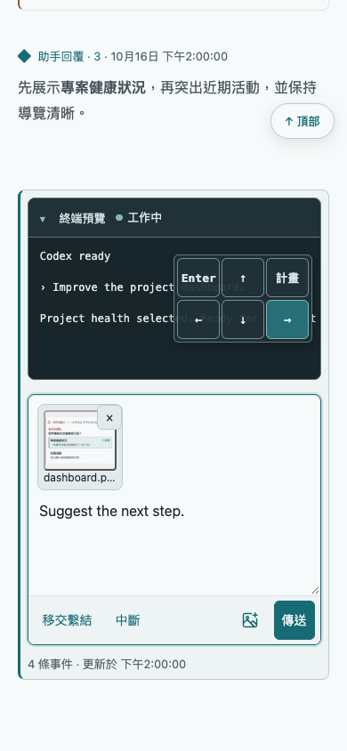
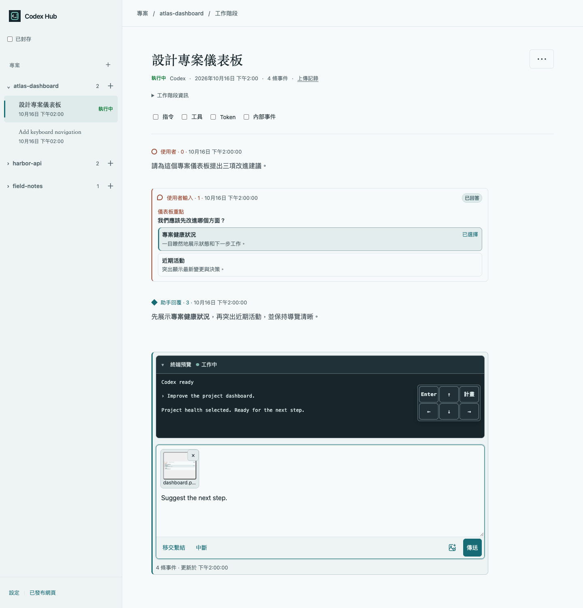

# Codex Hub

[English](README.md) | [简体中文](README.zh-CN.md) | 繁體中文

面向 Codex 的本地網頁中心，將清晰易讀的工作階段記錄與即時 CLI 互動結合起來。
按專案瀏覽工作階段、跟進最新回覆，並從電腦或手機繼續工作。



<details>
<summary>手機截圖</summary>





</details>

## 快速開始

執行要求：

- macOS 或 Linux，Node.js >=22.13 與 npm
- 本地 Codex Home（通常為 `~/.codex`）
- 支援 `resume`、`--no-daemon`、`--no-alt-screen`、`--worktree`、`archive` 和 `delete --force` 的 Codex CLI
- tmux，用於建立工作階段和互動

請使用所選 Node.js 版本系列的最新安全修補版本。開發與完整檢查需要 Node.js
`^22.22.2 || ^24.15.0 || >=26.0.0`，參見[開發指南（英文）](docs/development.md)。

無需全域安裝即可試用：

```sh
npx @someonegg/codex-hub@latest
```

也可以安裝後長期使用：

```sh
npm install -g @someonegg/codex-hub
codex-hub
```

開啟 <http://127.0.0.1:4173>。按 `Ctrl-C` 停止伺服器。
介面預設英文，在側邊欄底部開啟 **Settings → Language → 简体中文 / 繁體中文** 即可切換；選擇儲存在目前瀏覽器。

指定其他 Codex Home 或連接埠：

```sh
codex-hub --codex-home 'personal=/path/to/codex-home' --port 4180
```

使用多個 Codex Home：

```sh
codex-hub \
  --codex-home 'personal=~/.codex' \
  --codex-home 'work=/path/to/codex-work'
```

詳見[多個 Home](docs/usage.zh-TW.md#多個-home)。如需託管靜態網頁或審閱差異，啟用可選託管功能：

```sh
codex-hub --hosting
```

詳見[發布資源](docs/usage.zh-TW.md#發布資源)。升級時再次執行
`npm install -g @someonegg/codex-hub@latest`。從原始碼執行請參閱[開發指南（英文）](docs/development.md)。

## 功能

- 按專案瀏覽主工作階段和子工作階段。
- 閱讀 Markdown、程式碼、表格和數學公式，可選顯示技術事件。
- 瀏覽歷史記錄的同時跟進工作階段更新。
- 建立工作階段，可選 worktree；傳送輸入並預覽終端。
- 檢視執行中的工作階段、安全恢復已退出工作階段、退出而不封存，以及管理封存記錄。
- 在英文、簡體中文與繁體中文之間切換介面。

## 工作階段互動

在工作階段頁面傳送提示並控制即時終端。可以拍照、貼上圖片或拖放檔案，預覽後傳送。
上傳儲存、清理和限制見[檔案上傳](docs/usage.zh-TW.md#檔案上傳)。

<details>
<summary>檢視工作階段互動截圖</summary>



</details>

### 終端預覽

展開**終端預覽**跟進即時 CLI。使用螢幕按鈕，或聚焦預覽後按方向鍵及 **Enter**，處理 CLI 提示。
按 **Esc** 或點選**中斷**可中斷執行。**工作中**與**閒置**僅反映近期終端輸出，不代表任務完成。

### 移交繫結後繼續

當 Codex 在同一終端中透過 `/clear`、`/resume` 或執行計畫切換工作階段時，在舊工作階段頁面點選**移交繫結**。
顯示**已被替代**後，點選**前往已繫結工作階段**。未傳送草稿保留在舊頁面。
詳見[與 Codex 互動](docs/usage.zh-TW.md#與-codex-互動)。

## 安全

Codex Hub 讀取本地工作階段日誌與索引，透過 tmux 互動，並使用原生 CLI 命令管理工作階段。
身分認證由 Codex 負責；Hub 不讀取或管理權杖、API 金鑰或認證資料檔案。

伺服器預設僅監聽回送位址，互動和管理功能沒有應用層登入保護。對外開放前，請新增身分認證
（例如內建 mTLS）並限制存取。參閱[安全說明](docs/usage.zh-TW.md#安全)。

## 文件

- [使用與設定](docs/usage.zh-TW.md)
- [技術參考（英文）](docs/technical-reference.md)
- [開發與截圖（英文）](docs/development.md)
- [全部文件與架構決策](docs/README.md)
