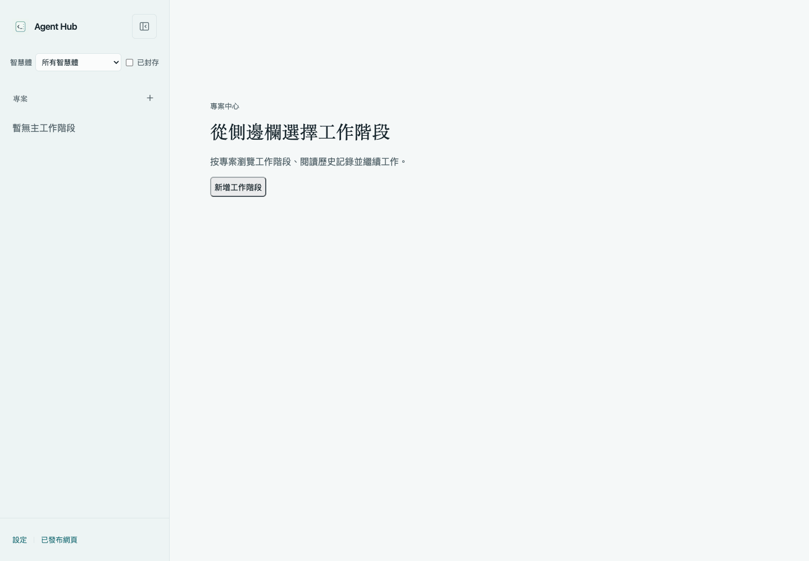
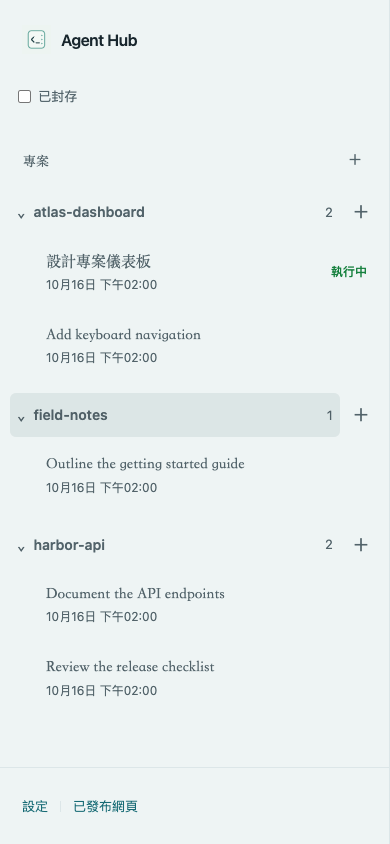
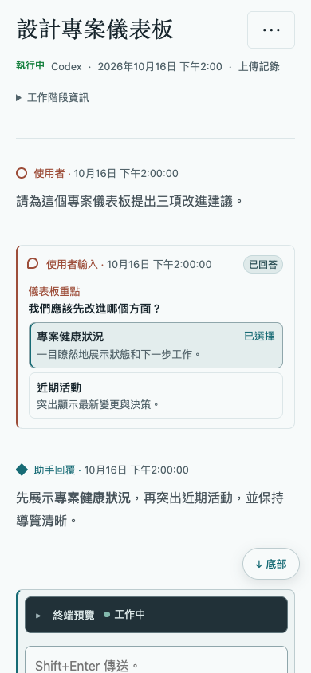
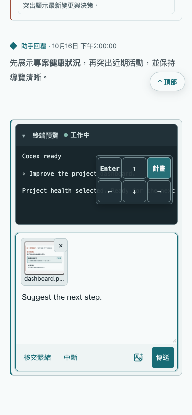
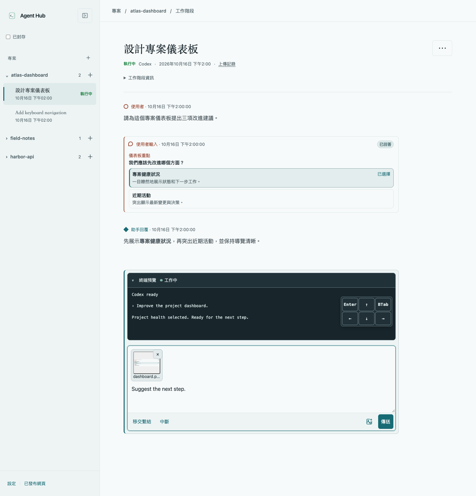

# Agent Hub

[English](README.md) | [简体中文](README.zh-CN.md) | 繁體中文

面向 Codex 和 Claude Code 的本地網頁中心，將清晰易讀的工作階段記錄與即時 CLI 互動結合起來。
按專案瀏覽工作階段、跟進最新回覆，並從電腦或手機繼續工作。



<details>
<summary>手機截圖</summary>





</details>

## 快速開始

執行要求：

- macOS 或 Linux，Node.js >=22.13 與 npm
- 至少一種已設定的本機 CLI：Codex 或 Claude Code
- tmux，用於建立、恢復工作階段和互動

Hub 預設讀取 `~/.codex` 和 `~/.claude`，兩種執行環境可單獨或同時使用。
自訂目錄見[多個智慧體設定](docs/usage.zh-TW.md#多個智慧體)。

無需全域安裝即可試用：

```sh
npx @someonegg/agent-hub@latest
```

也可以安裝後長期使用：

```sh
npm install -g @someonegg/agent-hub
agent-hub
```

開啟 <http://127.0.0.1:4173>。按 `Ctrl-C` 停止伺服器。
介面預設英文，在側邊欄底部開啟 **Settings → Language → 简体中文 / 繁體中文** 即可切換；選擇儲存在目前瀏覽器。

智慧體、連接埠與可選網頁／差異託管設定見[使用與設定](docs/usage.zh-TW.md)。

升級時再次執行
`npm install -g @someonegg/agent-hub@latest`。從原始碼執行請參閱[開發指南（英文）](docs/development.md)。

## 功能

- 按專案瀏覽主工作階段和子工作階段。
- 閱讀工作階段訊息、計畫和使用者輸入，支援 Markdown、程式碼、表格和數學公式。
- 瀏覽歷史記錄的同時跟進工作階段更新。
- 建立工作階段，可選 worktree；傳送輸入並預覽終端。
- 檢視執行中的工作階段、恢復已退出工作階段、停止工作階段執行，以及封存或刪除歷史記錄。
- [發布靜態網頁和檢視程式碼差異](docs/usage.zh-TW.md#發布網頁與差異)，可選啟用本機託管。
- 在英文、簡體中文與繁體中文之間切換介面。

## 工作階段互動

在工作階段頁面傳送提示並控制即時終端。可以拍照、貼上圖片或拖放檔案，預覽後傳送。
上傳儲存、清理和限制見[檔案上傳](docs/usage.zh-TW.md#檔案上傳)。

<details>
<summary>檢視工作階段互動截圖</summary>



</details>

展開**終端預覽**跟進 CLI，並透過螢幕按鈕處理提示。
快捷鍵、中斷與 Codex 工作階段移交詳見[與工作階段互動](docs/usage.zh-TW.md#傳送提示與檔案)。

## 透過管理 CLI 操作工作階段

使用 `ahub-cli session` 在另一個終端中列出、建立、恢復、檢視和管理工作階段，或向執行中的工作階段傳送輸入。
新增 `--json` 可輸出結構化結果，方便指令碼和智慧體工作流程使用。
命令與範例見[工作階段 CLI 使用說明](docs/usage.zh-TW.md#工作階段命令)。

如需智慧體協助管理工作階段，可使用 npm 套件附帶的
[`ahub-control` skill](skills/ahub-control)。執行
`ahub-cli skill path ahub-control` 查看目錄。`npx` 回傳快取路徑，長期使用請複製該目錄。

## 安全

Agent Hub 讀取本機工作階段記錄，透過 tmux 控制已連線的 CLI 工作階段。
模型存取與身分認證由所設定的 Codex 或 Claude Code CLI 負責；Hub 不管理 API 金鑰或 CLI 認證資料。

伺服器預設僅監聽回送位址，互動和管理功能沒有應用層登入保護。對外開放前，請新增身分認證
（例如內建 mTLS）並限制存取。參閱[安全說明](docs/usage.zh-TW.md#從其他裝置存取)。

## 文件

- [使用與設定](docs/usage.zh-TW.md)
- [技術參考（英文）](docs/technical-reference.md)
- [開發與截圖（英文）](docs/development.md)
- [全部文件與架構決策](docs/README.md)
